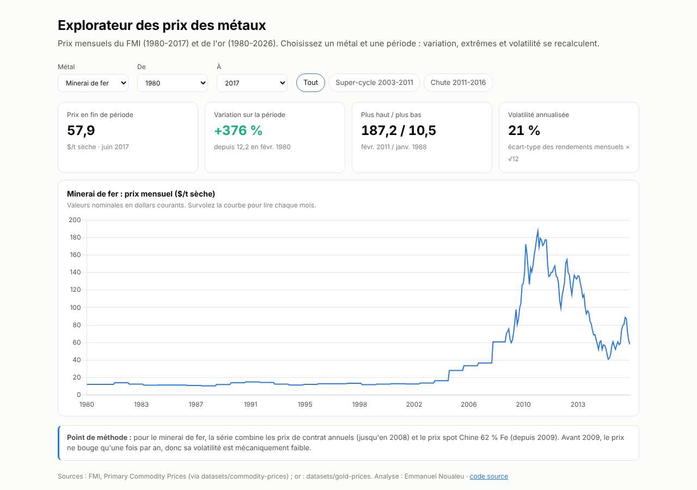
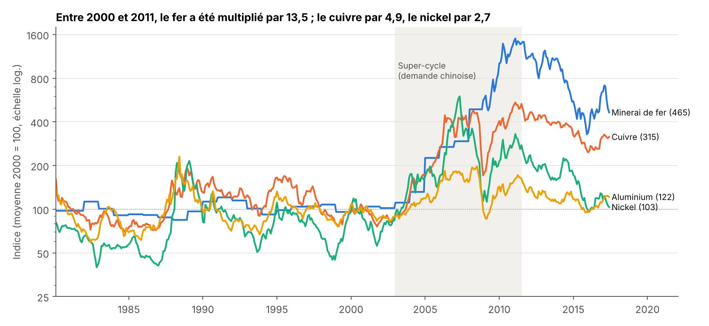
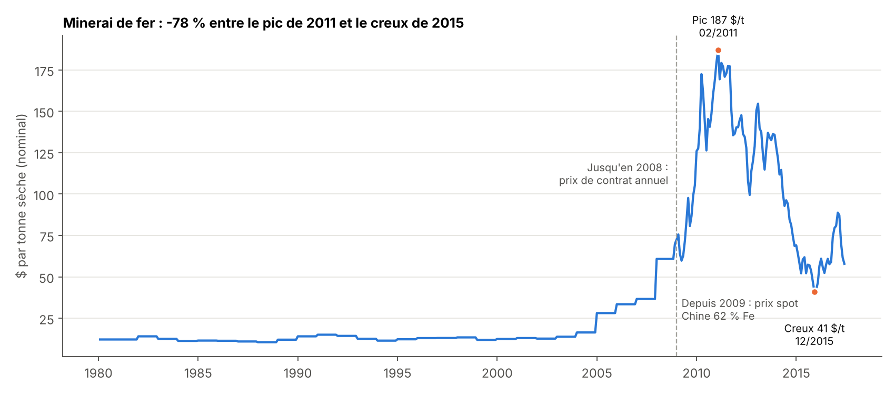
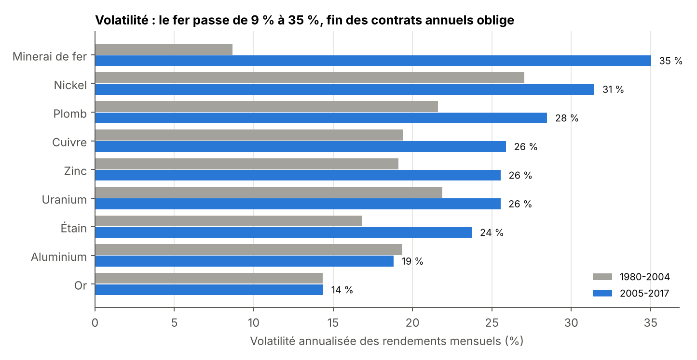
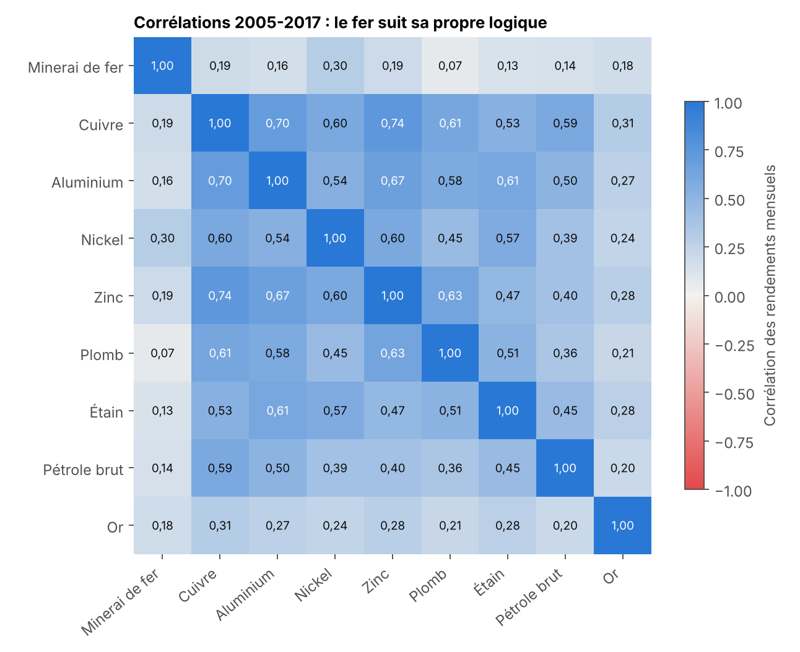

# Marché des métaux 1980-2017 : ce que 37 ans de prix apprennent à un projet minier

> **English summary**
>
> - **Problem:** a mining project is decided on a future selling price. Which price should it assume, and what risk should it accept?
> - **Data:** IMF monthly prices for 10 commodities (iron ore, copper, aluminium, nickel, zinc, lead, tin, uranium, coal, oil), 1980-2017, plus gold prices up to October 2026.
> - **Method:** base-100 indices, cycle analysis, annualised volatility by period, correlations of monthly returns (Python, pandas, matplotlib), interactive explorer.
> - **Result:** iron ore rose 13.5x between 2000 and 2011, then lost 78% in less than 5 years. Over 2010-2017, the gap between a "good" and a "bad" month ranges from $57 to $170/t.
>
> *The detailed write-up below is in French. Code, figures and results are language-independent.*

**Python (pandas, matplotlib) · séries temporelles · volatilité · corrélations · explorateur interactif**

> - **Le problème :** un projet minier se décide sur un prix de vente futur. Quel prix retenir, et quel risque accepter ?
> - **Les données :** prix mensuels du FMI pour 10 matières premières (fer, cuivre, aluminium, nickel, zinc, plomb, étain, uranium, charbon, pétrole), 1980-2017, et prix de l'or jusqu'en octobre 2026.
> - **La méthode :** indices en base 100, analyse des cycles, volatilité annualisée par période, corrélations des rendements mensuels.
> - **Le résultat :** le minerai de fer a été multiplié par 13,5 entre 2000 et 2011, puis a perdu 78 % en moins de 5 ans. Sur 2010-2017, l'écart entre un « bon » et un « mauvais » mois va de 57 à 170 $/t.

**[▶ Ouvrir l'explorateur interactif](https://emmanuelnoualeu.github.io/projets/metaux/)** : choisissez un métal et une période, et la variation, les extrêmes et la volatilité se recalculent.



---

## 1. Le super-cycle des matières premières (2003-2011)



Entre la moyenne de 2000 et celle de 2011, le prix du **minerai de fer a été multiplié par 13,5**, celui du cuivre par 4,9, du nickel par 2,7 et de l'aluminium par 1,5. Le fer, matière première de l'acier, a le plus profité de l'urbanisation chinoise. C'est aussi lui qui est le plus exposé à son ralentissement.

*Nuance de lecture :* une partie du saut de 2008-2010 vient d'un changement de série. On passe de prix de contrat annuels à un prix spot rendu en Chine, qui inclut le fret.

## 2. Minerai de fer : de 187 $ à 41 $ la tonne



| Repère | Valeur |
|---|---|
| Moyenne 2000 | 12,4 $/t |
| Moyenne 2011 | 167,8 $/t |
| Pic | **187,2 $/t** (février 2011) |
| Creux | **40,9 $/t** (décembre 2015), soit **−78 %** |
| Prix spot 2010-2017 : P10 / médiane / P90 | 56,5 / 120,9 / 169,5 $/t |
| Mois sous 60 $/t entre janvier 2014 et juin 2017 | 17 sur 42 |

**Ce que cela implique pour un projet de fer.** Un gisement de type BIF (itabirite à 30-40 % Fe) doit être concentré pour atteindre la qualité de référence de 62-65 % Fe. Une étude économique calée sur la médiane 2010-2017 (≈ 120 $/t) aurait surestimé le prix 40 mois sur 42 entre janvier 2014 et juin 2017 : le prix moyen n'y a été que de 71 $/t, et il est passé sous 60 $/t pendant 17 mois. Le prix de référence d'une étude de faisabilité doit donc être testé **au moins au P10 historique**, et pas seulement à la moyenne.

## 3. La volatilité a changé de nature



| Métal | 1980-2004 | 2005-2017 |
|---|---|---|
| Minerai de fer | 8,7 % | **35,0 %** |
| Nickel | 27,0 % | 31,5 % |
| Plomb | 21,6 % | 28,5 % |
| Cuivre | 19,4 % | 25,9 % |
| Zinc | 19,1 % | 25,6 % |
| Uranium | 21,9 % | 25,5 % |
| Étain | 16,8 % | 23,7 % |
| Aluminium | 19,3 % | 18,8 % |
| Or | 14,3 % | 14,4 % |

Le fer est passé du métal le plus stable au plus volatil. C'est la fin des contrats annuels (2009-2010) : le prix bouge désormais chaque jour. Pour un producteur, cela signifie des flux de trésorerie bien plus incertains, et un besoin de couverture (contrats à terme, clauses d'indexation) qui n'existait pas avant.

## 4. Le fer ne se diversifie pas avec les métaux de base



Sur 2005-2017, les métaux de base évoluent ensemble : cuivre, zinc et aluminium sont corrélés entre 0,67 et 0,74. Le minerai de fer, lui, n'est corrélé qu'à 0,07-0,30 avec eux. Son prix dépend presque uniquement de la sidérurgie chinoise. Pour un investisseur, un portefeuille fer + cuivre diversifie mieux que cuivre + zinc.

## 5. L'or, valeur refuge

L'or a la volatilité la plus faible de l'échantillon (14 %) et une corrélation modérée avec les autres métaux (0,18 à 0,31). Son prix est passé de 284 $/once en janvier 2000 à 1 260 $ en juin 2017, puis **4 105 $ en octobre 2026** (série prolongée jusqu'à cette date dans l'explorateur).

---

## Reproduire l'analyse

```bash
pip install -r requirements.txt
python src/analyse_metaux.py   # figures, chiffres clés, données de l'explorateur
```

```
├── data/
│   ├── prix_matieres_premieres_fmi.csv   # FMI, mensuel, 1980-2017
│   └── prix_or_mensuel.csv               # or, mensuel, 1833-2026
├── src/analyse_metaux.py
├── resultats/                            # chiffres clés, volatilité, corrélations
├── dashboard/                            # explorateur HTML interactif (Chart.js)
└── figures/
```

**Sources :** Fonds monétaire international, *Primary Commodity Prices*, via [datasets/commodity-prices](https://github.com/datasets/commodity-prices) ; or : [datasets/gold-prices](https://github.com/datasets/gold-prices). Prix nominaux en dollars courants, non corrigés de l'inflation.

**Limites :** la série FMI publiée s'arrête en juin 2017 ; prolonger l'analyse demande d'intégrer les données plus récentes du FMI ou de la Banque mondiale (« Pink Sheet »).

---

**Emmanuel Noualeu**, analyste de données et ingénieur minier · [Portfolio](https://emmanuelnoualeu.github.io) · [LinkedIn](https://www.linkedin.com/in/emmanuel-noualeu-b78bba24b/) · [Upwork](https://www.upwork.com/freelancers/~0146b1a5dfeefdd395) · [emmanuelnoualeu@gmail.com](mailto:emmanuelnoualeu@gmail.com)
